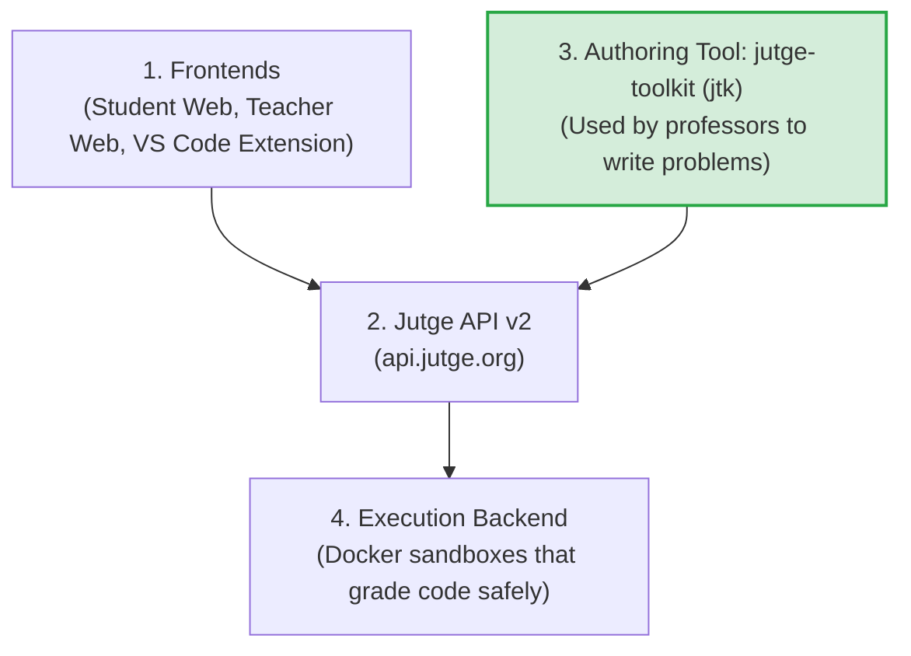

# 01 - Project Overview & Strategy

**Context:** UPC Master's Scholarship Project (4-Month Internship)  
**Main Focus:** `jutge-toolkit` (`jtk`)  
**Language Level:** Standard English (B2)

---

## 1. What is Jutge.org?

**Jutge.org** is an online educational platform made at the **Universitat Politècnica de Catalunya (UPC - BarcelonaTech)**. 

It is used every day by thousands of students and professors to:
- Practice computer programming in university lab classes.
- Automatically grade student code (Accepted, Wrong Answer, Time Limit Exceeded).
- Host university exams and programming contests (like the Catalan Olympiad in Informatics, OIcat).

---

## 2. Key People You Work With

- **Prof. Jordi Petit:** Main creator and lead architect of Jutge.org and the `jutge-toolkit` (`jtk`).
- **Prof. Salvador Roura:** Author of core algorithm problems and university course materials.
- **Prof. Jordi Cortadella:** Contest coordinator and professor.
- **Pau Fernández:** Co-maintainer of `jtk` and web applications.

---

## 3. High-Level Ecosystem (The Big Picture)

The Jutge ecosystem has 4 main layers. You only need to focus on **Layer 3**:

1. **User Frontends:** 
   - `jutge-web-new`: Modern student website (`new.jutge.org`).
   - `jutge-web-prof`: Dashboard for professors to manage classes and exams.
   - `jutge-vscode`: Extension so students can submit code directly inside VS Code.
2. **API Layer (`api.jutge.org`):** 
   - Connects all tools and databases using REST and streaming.
3. **Authoring Tool (`jutge-toolkit` / `jtk`) — YOUR MAIN JOB:** 
   - A command-line tool used by professors to write, build, test, and upload problems.
4. **Grading Backend:** 
   - Safe Linux containers (Docker) that compile student code and check outputs.

---

## 4. The Golden Rule of Jutge Problems

> ⚠️ **IMPORTANT RULE:**  
> In Jutge, correct output files (`*.cor`) are **never written by hand and never written by an AI**.  
> They are always created automatically by running the **golden solution** (`solution.cc`) on the input files (`*.inp`).

---

## 5. Your Scholarship Strategy: "Show More, Do Less"

As an intern, your goal is to make **visible, high-impact improvements** without getting stuck in dangerous code:

- **What to Avoid (Initially):**  
  Do not work on backend drivers (`jutge-driver-std`, `jutge-dockerfiles`). They deal with low-level Linux kernel settings (`cgroups`, permissions). If you break them, university exams across UPC can fail.
- **Where to Focus (The Sweet Spot):**  
  Focus on **`jutge-toolkit` (`jtk`)**. Professors use this tool every week to create exam problems. Any feature that makes problem authoring faster or less error-prone will directly impress your professors.
