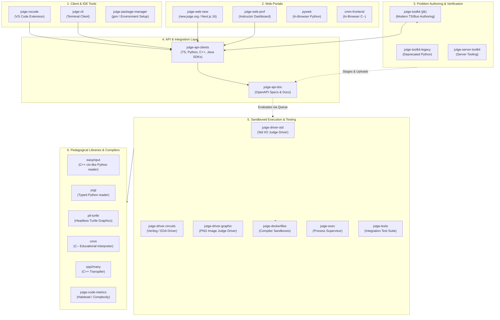
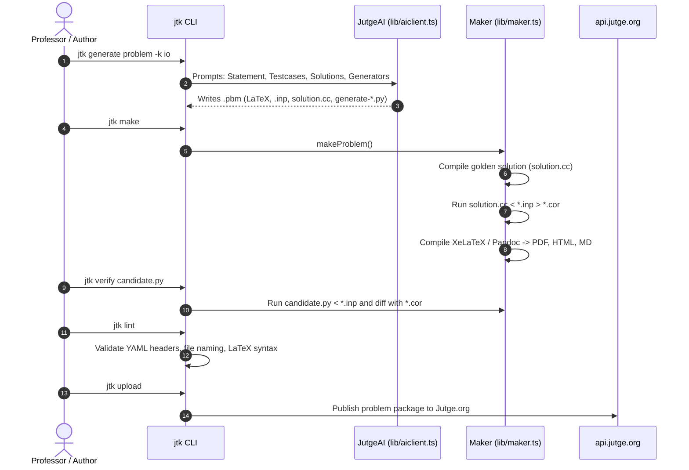

# Jutge.org Ecosystem Architecture & `jutge-toolkit` (`jtk`) Deep Dive

**Date:** October 22, 2026  
**Context:** UPC Master's Scholarship Project — Jutge.org Core Tooling & Problem Authoring  
**Author:** Scholarship Research & Engineering Team  
**Document Purpose:** Comprehensive architectural study of all 31 cloned repositories in `jutge_repos/`, followed by an exhaustive technical deep-dive into `jutge-toolkit` (`jtk`), its JutgeAI problem authoring engine, and actionable high-impact project proposals.

---

## 1. High-Level Taxonomy of the Jutge Ecosystem

The Jutge.org platform is composed of 31 interrelated repositories. Below is the complete structural taxonomy organized by architectural layer and functional domain:



---

## 2. Detailed Breakdown of Cloned Repositories

### Group 1: Developer, Authoring & Client Tools
1. **[`jutge-toolkit`](https://github.com/jutge-org/jutge-toolkit) (`jtk`)**: The modern problem authoring CLI written in TypeScript / Bun. Used by professors to create, compile, verify, and upload problem packages (`.pbm`). Features full `JutgeAI` generation.
2. **`jutge-toolkit-legacy`**: The previous generation of `jtk` written in Python (`jutge-make-problem`). Officially deprecated; maintained for reference on legacy problem configurations.
3. **`jutge-cli`**: The student/instructor command-line interface (`jutge` command). Enables authentication, submission viewing, course inspection, and file transfers over API v2.
4. **`jutge-package-manager` (`jpm`)**: Cross-platform environment bootstrapper. Installs compilers (Clang, GCC, GHC, Python), VS Code extensions, and Jutge tools with one-command formulas (`jpm use cpp`).
5. **`jutge-vscode`**: The official Visual Studio Code extension. Allows students to log in, view problem statements, execute code against sample test cases locally, and receive live verdict notifications.

### Group 2: Modern Web Portals
6. **`jutge-web-new` (`new.jutge.org`)**: The modern student-facing web portal built with Next.js 16 (App Router), React 19, and Tailwind CSS 4. Features Monaco editor integration, submission diff viewers, and responsive student dashboards.
7. **`jutge-web-prof`**: The dedicated professor web portal. Includes class roster management, exam controls, grading analytics, and problem authoring interfaces.
8. **`pyweb`**: A browser-embedded lightweight Python runner.
9. **`cmm-frontend`**: The web interface for interactive step-by-step memory visualization of C-- programs.

### Group 3: Core API & SDK Generation
10. **`jutge-api-doc`**: The OpenAPI v2 documentation portal and endpoint specification repository powering `api.jutge.org`.
11. **`jutge-api-clients`**: Multi-language SDK generator. Ingests API specs and generates strictly typed client libraries for TypeScript, Python, C++, Java, PHP, and JavaScript.
12. **`jutge-server-toolkit`**: Internal server-side utilities used by Jutge administrators to manage system queues and problem storage.

### Group 4: Execution Sandbox, Drivers & Grading
13. **`jutge-driver-std`**: The standard execution driver (Python). Evaluates console-based programs (`stdin`/`stdout`), applies resource limits (time, memory), diffs outputs, and issues verdicts (`AC`, `WA`, `TLE`, `MLE`, `RTE`, `CE`).
14. **`jutge-driver-circuits`**: Special driver for digital circuit problems written in Verilog, executing formal equivalence checkers.
15. **`jutge-driver-graphic`**: Special driver for graphical assignments; executes student code headlessly and performs perceptual image diffing against golden PNG images.
16. **`jutge-dockerfiles`**: Multi-compiler container recipes providing hardened runtime environments for over 40 programming languages.
17. **`jutge-exec`**: Low-level process supervisor enforcing non-privileged user isolation (`nobody`), process tree limits, and syscall filtering.
18. **`jutge-tests`**: Integration test harness validating the end-to-end evaluation cycle across different compilers and resource limits.

### Group 5: Pedagogical Libraries & Compilers
19. **`easyinput`**: Widely used Python library mimicking C++ `cin >>` tokenized input streaming for beginning students.
20. **`yogi`**: Modern, statically typed successor to `easyinput` created in 2024 by Prof. Jordi Petit, supporting `mypy` and IDE type annotations (`read`, `scan`, `tokens`).
21. **`pil-turtle`**: Headless Python Turtle library built on top of PIL (Pillow) that draws directly to `output.png`, allowing automated graphical judging.
22. **`cmm` (C--)**: Lightweight C++ interpreter and AST visualizer for introductory programming pedagogy.
23. **`cpp2many`**: AST-based code transpiler converting simple C++ student code into Python, Java, Pascal, or Ada.
24. **`jutge-code-metrics` / `code-metrics`**: Static analysis engine measuring lines of code, cyclomatic complexity (via Lizard), and Halstead metrics.
25. **`jutge-util`**: Python utility library for internal Jutge operations.

### Group 6: Auxiliary Services & Brand Assets
26. **`callmebot`**: Messaging integration (Telegram / WhatsApp) for automated system alerts.
27. **`jutge-logos`**: Vector and raster assets, seasonal logos, and evaluation semaphore indicators.
28. **`jutge-diplomes-oicat`**: Automated PDF certificate and diploma generator for the Catalan Olympiad in Informatics.
29. **`jutge-vinga-bin`**: High-speed compiled binaries for Jutge's fast-test execution engine.

---

## 3. Deep-Dive Focus: `jutge-toolkit` (`jtk`)

### 3.1 Architectural Overview
The `jutge-toolkit` repository is the **primary focal point of your scholarship**. It is written entirely in modern TypeScript and executed under **Bun**.

```text
jutge-toolkit/
├── toolkit/                  # CLI Command Dispatchers (Commander.js)
│   ├── index.ts              # Entrypoint (jtk, jutge-toolkit)
│   ├── generate.ts           # JutgeAI generation commands
│   ├── make.ts               # Compilation & artifact builder
│   ├── verify.ts             # Candidate solution verifier
│   ├── lint.ts               # Problem schema validator
│   ├── stage.ts              # Package staging for deployment
│   ├── upload.ts             # API v2 publisher
│   ├── clone.ts              # Template problem bootstrapper
│   └── doctor.ts             # System dependency checker
├── lib/                      # Core Domain Logic
│   ├── aiclient.ts           # ChatBot wrapper, API v2 SSE streaming, eco-audit
│   ├── create-io.ts          # IOProblemGenerator (Standard I/O problems)
│   ├── create-funcs.ts       # FuncsProblemGenerator (Function problems)
│   ├── maker.ts              # Build orchestrator (compilation, output generation)
│   ├── problem.ts            # .pbm file system entity model
│   └── stager.ts             # Directory packaging logic
└── assets/                   # Templates & Assets
    ├── prompts/              # Handlebars prompt templates
    └── latex/                # Jutge LaTeX styling macros
```

### 3.2 The Complete Problem Authoring Lifecycle
The diagram below illustrates how an author interacts with `jtk`:



### 3.3 Core Commands Breakdown

| Command | Action Performed | Key Files Involved |
|---|---|---|
| `jtk clone [template]` | Clones an authentic demo problem (e.g. `demo`, `quiz`, `funcs`) to start from. | `toolkit/clone.ts`, `assets/problems/` |
| `jtk generate problem` | Uses JutgeAI to draft an entire problem directory from a specification. | `toolkit/generate.ts`, `lib/create-io.ts`, `lib/create-funcs.ts` |
| `jtk generate translations` | Translates an existing LaTeX statement to Catalan (`ca`), Spanish (`es`), French, German. | `lib/generate.ts` |
| `jtk generate solutions` | Synthesizes idiomatic alternative solutions (Python, Rust, Haskell) from the golden solution. | `lib/generate.ts`, `assets/prompts/io/proglangs/` |
| `jtk generate generators` | Generates Python input generation scripts (`random`, `hard`, `efficiency`). | `assets/prompts/io/generators/` |
| `jtk make [tasks]` | Compiles solutions, runs golden solution to produce `*.cor`, and compiles PDFs/HTML. | `toolkit/make.ts`, `lib/maker.ts` |
| `jtk verify <solution>` | Compiles/runs candidate solutions and compares their output against the `.cor` files. | `toolkit/verify.ts` |
| `jtk lint` | Inspects `.pbm` directory for missing files, invalid YAML, or formatting mistakes. | `lib/lint.ts` |
| `jtk stage` | Creates a production-ready zip archive structured for the Jutge backend. | `lib/stager.ts` |
| `jtk upload` | Pushes staged archive to Jutge.org via API v2. | `toolkit/upload.ts`, `lib/upload.ts` |
| `jtk doctor` | Verifies local installation of compilers (GCC, Clang, Python, Pandoc, XeLaTeX). | `lib/doctor.ts` |

---

## 4. Why `jtk` is the Professor's Primary Need

From the context of the professor emails and scholarship discussions:
1. **High Volume of Problem Design:** Instructors like Jordi Petit and Salvador Roura create dozens of new exercises for each semester's exams and weekly labs.
2. **Authoring Fatigue:** Writing problem statements, translating them into Catalan and Spanish, finding tricky edge cases, writing Python input generators, and producing alternative solutions in multiple languages is labor-intensive.
3. **The Risk of Defective Problems:** If a newly authored problem has an edge case that causes the golden solution to loop infinitely or a Python generator that crashes on boundary inputs, students suffer during graded lab exams.
4. **Current Status of `jtk generate problem`:** While `jtk` contains a sophisticated prompt pipeline, **it operates in an open loop**. It generates code and writes it to disk without ever compiling or verifying it.

---

## 5. Architectural Gaps & High-Impact Scholarship Proposals

Based on our thorough study of `jutge-toolkit`'s source code, here are four concrete, achievable engineering initiatives that align directly with what your professors need:

### Proposal 1: Self-Correcting Closed-Loop Generation Engine (Highest Impact)
* **Current Limitation:** In `lib/create-io.ts`, the generator prompts the model for `solution.cc` and `test-*.inp`, writes them to disk, and exits. If the LLM introduced a syntax error or logic flaw, the author only discovers it later during `jtk make`.
* **Proposed Solution:** Implement an automated validation loop inside `IOProblemGenerator.run()`:
  ```
  LLM generates Solution & Test Cases
             │
             ▼
  jtk automatically compiles Golden Solution (via lib/maker.ts)
             │
      ┌──────┴──────┐
   Success        Failure
      │             │
      ▼             ▼
  Generate .cor   Feed compiler error / trace back to LLM for auto-repair
                    (Repeat up to 3 attempts until zero-exit)
  ```
* **Why Professors Will Love This:** Guarantees that every problem package drafted by `jtk generate problem` compiles cleanly and executes without runtime errors out of the box.

### Proposal 2: Immediate Testcase Generator Validation
* **Current Limitation:** Python scripts `generate-random.py`, `generate-hard.py`, and `generate-efficiency.py` are written to disk but never tested during generation. Often, imported modules are missing or arguments fail.
* **Proposed Solution:** Immediately invoke the newly generated scripts:
  ```bash
  python3 generate-random.py 5 42
  python3 generate-hard.py 5 42
  ```
  Validate that they output non-empty text, exit with code 0, and conform to the expected input specification.

### Proposal 3: Expand Function Problems (`funcs`) to C++ and Java
* **Current Limitation:** `lib/create-funcs.ts` currently only supports Python, Haskell, and Clojure (using `RunPython`, `RunHaskell`, `RunClojure`).
* **Proposed Solution:** Introduce driver harnesses and template scaffolding for **C++ (`RunCC`)** and **Java**. Because introductory algorithm courses at UPC (e.g., PRO1, PRO2) heavily teach C++, professors currently cannot use `jtk generate problem -k funcs` for their primary classes. Adding C++ function support provides immediate utility.

### Proposal 4: Automated Sample Input/Output Syncing in Statements
* **Current Limitation:** LaTeX statements contain `\Input` and `\Output` descriptions, but the sample data illustrated in the text must often be manually copied from the generated `.inp` and `.cor` files.
* **Proposed Solution:** Hook `lib/create-io.ts` directly into `lib/maker.ts` to automatically format the verified sample input and its deterministic execution output into the LaTeX statement's sample tables.

---

## 6. Actionable Next Steps for Development

1. **Verify Local Environment:**
   Run `bun run build` and `bun test` inside `jutge_repos/jutge-toolkit` to confirm the local build succeeds.
2. **Review Open Issues:**
   Inspect open issues and recent commits in `jutge-toolkit` to observe recent refactorings by Jordi Petit and Pau Fernández.
3. **Prototype Proposal 1 (Closed-Loop Validation):**
   Create a prototype branch in `jutge-toolkit` that imports `Maker` into `lib/create-io.ts` and runs a local verification step before saving the problem directory.
