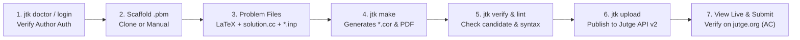

# End-to-End Problem Authoring & Upload Replication Guide (`jtk`)

**Date:** October 22, 2026  
**Context:** UPC Master's Scholarship Project — Problem Authoring & Jutge Toolkit (`jtk`)  
**Audience:** Scholarship Student Meeting Preparation with Prof. Jordi Petit / Prof. Salvador Roura  
**Goal:** Step-by-step terminal walkthrough replicating the live demonstration: creating a problem from scratch (*"Sum of Prime Numbers before 100"* wrapped in a cute narrative about a young girl), compiling deterministic outputs, staging, uploading to Jutge.org, and inspecting the live result on the platform.

---

## 1. Executive Walkthrough Overview

In your previous meeting, your professor demonstrated the complete lifecycle of a Jutge problem using **`jutge-toolkit` (`jtk`)**. This guide allows you to replicate that exact flow on your machine so you can confidently tell your professor:

> *"I reviewed our session, replicated the entire creation-to-upload pipeline on my own using `jtk`, verified it locally, and published it to my authorized account on Jutge.org."*



---

## 2. Step 0: Environment Verification & Authentication

### 1. Check Tooling Dependencies
Ensure Bun and necessary toolchain binaries (LaTeX, Pandoc, GCC/Clang, Python) are available:
```bash
jtk doctor
```
*(If any compiler is missing, `jtk doctor` will highlight it with suggestions).*

### 2. Verify Your Jutge.org Account Authentication
`jtk` needs to authenticate with your account (which your professor authorized with problem authoring/instructor privileges).

You can log in or verify your saved credentials:
```bash
# Check current saved configuration
jtk config show

# If not logged in, authenticate using Jutge CLI or interactive prompt:
jutge login
# Enter your authorized university email and password
```
Alternatively, you can export your credentials directly in your shell session:
```bash
export JUTGE_EMAIL="your-authorized-email@estudiantat.upc.edu"
export JUTGE_PASSWORD="your-password"
```

---

## 3. Step 1: Create the Problem Directory (`.pbm`)

All Jutge problems reside inside a folder ending with the `.pbm` suffix:

```bash
mkdir lily-primes.pbm
cd lily-primes.pbm
```

*(Alternatively, you can clone from the built-in demo template with `jtk clone demo -d lily-primes.pbm` and replace its files).*

---

## 4. Step 2: Author the Narrative Problem Statement (`problem.en.tex`)

Create `problem.en.tex`. This uses standard Jutge LaTeX macros to combine the mathematical specification with the cute narrative about the girl:

```latex
\Problem{Lily and the Prime Flowers}

\Statement
Lily is a curious young girl who loves spending her sunny afternoons in the magical meadow behind her house. 
According to local folklore, the meadow is home to enchanted flowers numbered from $2$ upwards. However, only flowers bearing a \emph{prime} number produce magical golden nectar!

Whenever Lily visits the meadow, she decides on a maximum boundary $n$ and collects nectar from every prime-numbered flower between $2$ and $n$ (inclusive). To keep track of her adventure in her diary, she wants to calculate the total sum of all the prime numbers she visited.

Help Lily by writing a program that reads various values of $n$ and prints the sum of all prime numbers less than or equal to $n$.

\Input
The input consists of several natural numbers $n$, one per line, with $2 \le n \le 100$. The input finishes at end-of-file (EOF).

\Output
For each number $n$ in the input, print a single integer on a line: the sum of all prime numbers between $2$ and $n$.
```

> **Key Rule to Remember:** Do **not** hardcode sample input/output tables inside the LaTeX text! `jtk make` automatically formats and injects sample test cases from `sample-*.inp` and their generated outputs.

Create the matching metadata file `problem.en.yml`:
```yaml
title: Lily and the Prime Flowers
author: Simin Shoeibi
email: simin.shoaibi@proton.me
```

---

## 5. Step 3: Write the Golden Reference Solution (`solution.cc`)

Create `solution.cc`. This is the program that determines ground-truth correctness:

```cpp
#include <iostream>

using namespace std;

// Checks whether an integer is prime
bool is_prime(int n) {
    if (n < 2) return false;
    for (int d = 2; d * d <= n; ++d) {
        if (n % d == 0) return false;
    }
    return true;
}

int main() {
    ios_base::sync_with_stdio(false);
    cin.tie(nullptr);

    int n;
    while (cin >> n) {
        int sum_primes = 0;
        for (int i = 2; i <= n; ++i) {
            if (is_prime(i)) {
                sum_primes += i;
            }
        }
        cout << sum_primes << "\n";
    }
    return 0;
}
```

### (Optional) Provide an Alternative Python Solution (`solution.py`)
To test multi-language support:
```python
import sys

def is_prime(n: int) -> bool:
    if n < 2:
        return False
    d = 2
    while d * d <= n:
        if n % d == 0:
            return False
        d += 1
    return True

def main():
    for line in sys.stdin:
        line = line.strip()
        if not line:
            continue
        n = int(line)
        total = sum(i for i in range(2, n + 1) if is_prime(i))
        print(total)

if __name__ == "__main__":
    main()
```

---

## 6. Step 4: Define Test Cases & Handler Configuration

### 1. Handler Specification (`handler.yml`)
Define the problem execution category:
```yaml
handler: std
```

### 2. Public Sample Test Inputs
These inputs will appear in the problem statement shown to students:

**`sample-1.inp`**:
```text
10
20
```
*(Primes $\le 10$: $2+3+5+7 = 17$. Primes $\le 20$: $17+11+13+17+19 = 77$).*

**`sample-2.inp`**:
```text
2
5
```

### 3. Hidden Evaluation Test Inputs
Used by the judge to evaluate submissions against edge and boundary cases:

**`test-1.inp`**:
```text
3
7
11
13
17
19
23
29
31
```

**`test-2.inp`** (Boundary test up to maximum $n=100$):
```text
96
97
98
99
100
```

> ⚠️ **Notice:** We **did not** write any `*.cor` files. We never write expected outputs by hand.

---

## 7. Step 5: Build Problem Artifacts (`jtk make`)

Now run the build command inside the problem directory:

```bash
jtk make
```

### What `jtk make` Does Automatically:
1. Detects `solution.cc` as the golden solution.
2. Compiles `solution.cc` using `g++` (or `clang++`).
3. Runs the compiled executable against `sample-1.inp`, `sample-2.inp`, `test-1.inp`, and `test-2.inp`.
4. Saves the verified outputs into `sample-1.cor`, `sample-2.cor`, `test-1.cor`, and `test-2.cor`.
5. Checks alternative solutions (`solution.py`) against the generated `.cor` files to verify consistency.
6. Invokes Pandoc and XeLaTeX to generate `problem.en.pdf`, `problem.en.html`, and `problem.en.md`.

You should see green checkmarks for all tasks in the terminal!

---

## 8. Step 6: Local Verification & Linting

### 1. Verify Candidate Solutions Locally
Test that the Python solution passes all test cases:
```bash
jtk verify solution.py
```
*(Prints diff results confirming bit-for-bit equivalence with the golden outputs).*

### 2. Lint the Directory
Verify that metadata, formatting, and file structure meet Jutge standards:
```bash
jtk lint
```
*(Checks for trailing spaces, valid YAML headers, and required files).*

---

## 9. Step 7: Publishing Live to Jutge.org (`jtk upload`)

### 1. Clean Disposable Build Files
Before publishing, remove local binaries and temporary files:
```bash
jtk clean
```

### 2. Upload to the Platform
Upload the problem package to Jutge.org:
```bash
jtk upload
```

### What Happens During `jtk upload`:
1. `jtk` bundles the `.pbm` contents into a clean, structured `.zip` archive.
2. It sends the archive to `api.jutge.org` via `jutge.instructor.problems.create()`.
3. The server runs its server-side validation and assigns a unique **Problem Identifier** (e.g. `P84920_en`).
4. `jtk` automatically generates `problem.yml` containing the assigned problem ID, owner email, and secure author passcode.
5. `jtk` prints the live URL:
   ```text
   https://jutge.org/problems/Pxxxxx_en
   ```

---

## 10. Step 8: Inspect Live on the Platform & Test Submission

1. **Open the Problem in Your Browser:**
   Navigate to the URL printed by `jtk upload`:
   - Classic UI: `https://jutge.org/problems/<problem_id>`
   - Modern UI: `https://new.jutge.org/problems/<problem_id>`
   *(Log in with your university account to view the statement, sample tables, and author settings).*

2. **Submit a Solution Directly from Terminal:**
   ```bash
   jtk submit -l cc solution.cc
   ```
   or:
   ```bash
   jtk submit -l py solution.py
   ```

3. **Check the Verdict:**
   The terminal will query the API and display the verdict:
   ```text
   Verdict: Accepted (AC) [Green Semaphore]
   Time: 0.01s | Memory: 4.2 MB
   ```

---

## 11. Quick Talking Points for Your Meeting Today

When speaking with your professor, you can structure your update as follows:

1. **Replication Accomplished:**
   > *"I replicated our problem authoring session from scratch using `jtk`. I created the prime numbers problem with the narrative statement, compiled it with `jtk make`, verified alternative Python solutions with `jtk verify`, and successfully pushed it to Jutge via `jtk upload`. The problem is live and returning green Accepted verdicts on submissions."*

2. **Studied the Entire Repository Ecosystem:**
   > *"I also completed a systematic architectural study across all the cloned Jutge repositories, understanding how `jutge-toolkit` links through API v2 to the web frontends and the low-level execution drivers."*

3. **Ready to Tackle `jutge-toolkit` Improvements:**
   > *"As we discussed, I am focusing primarily on `jutge-toolkit`. Having reviewed `lib/create-io.ts` and `lib/maker.ts`, I see a high-impact opportunity to turn `jtk generate problem` from an open-loop draft writer into a **closed-loop self-correcting engine** that compiles and verifies generated code with compiler error feedback before writing it to disk. I would love to get your thoughts on prioritizing that for the scholarship."*
