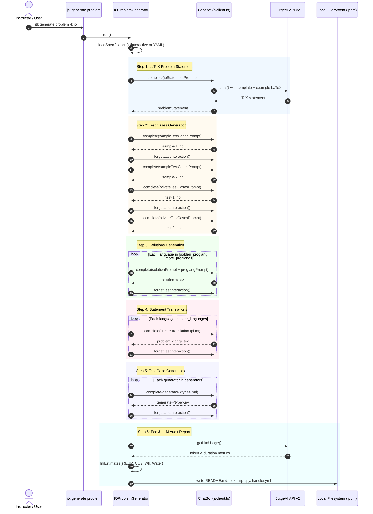
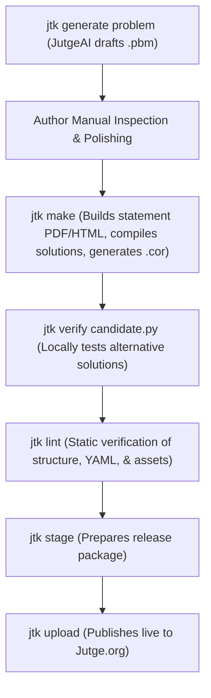

# Comprehensive Study & Technical Breakdown: `jutge-toolkit` and AI Problem Generation (`jtk generate problem`)

**Target Repository:** [`jutge-toolkit`](https://github.com/jutge-org/jutge-toolkit)  
**Context:** UPC Master's Scholarship Project — Jutge.org Problem Authoring & AI Generation Subsystem  
**Author:** Scholarship Research & Engineering Team  
**Date:** October 2026  

---

## 1. Executive Summary & Purpose

The **Jutge Toolkit (`jtk`)** is the modern command-line tool designed for professors, contest organizers, and problem authors to create, test, verify, format, and deploy programming problems to the [Jutge.org](https://jutge.org) automated judging platform.

Written in modern **TypeScript** and executed under the high-performance **Bun** runtime, `jutge-toolkit` serves as the primary authoring bridge between pedagogical problem design and Jutge.org's backend evaluation engine.

Within this toolkit, the **`JutgeAI`** subsystem (specifically the command `jtk generate problem`) represents the next-generation automated problem authoring pipeline. It leverages Large Language Models (LLMs) to synthesize complete, production-ready programming problem packages from high-level specifications—including LaTeX statements, golden solutions, multi-language alternative solutions, edge-case test suites, automated test case generator scripts, and full sustainability/audit reporting.

This study breaks down the complete architecture, source code mechanics, execution flows, and technical gaps of `jutge-toolkit`'s AI features, establishing a concrete engineering roadmap for upcoming development.

---

## 2. Global Architecture of `jutge-toolkit`

```
jutge-toolkit/
├── toolkit/                  # CLI Commands (Commander.js dispatchers)
│   ├── generate.ts           # 'jtk generate' commands (problem, translations, solutions, etc.)
│   ├── ask.ts                # 'jtk ask' AI-assisted toolkit QA documentation search
│   ├── make.ts               # 'jtk make' compiles solutions, runs testcases -> .cor, builds LaTeX/PDF
│   ├── verify.ts             # 'jtk verify' checks candidate solutions against testcases locally
│   ├── lint.ts               # 'jtk lint' structural and metadata validation
│   ├── stage.ts              # 'jtk stage' packages problem into Jutge.org deployment format
│   ├── upload.ts             # 'jtk upload' publishes problem to Jutge.org via API v2
│   └── index.ts              # Global CLI entrypoint
├── lib/                      # Core Logic & Engine
│   ├── aiclient.ts           # JutgeAI chat client, streaming parser, cost/carbon estimations
│   ├── create-io.ts          # IOProblemGenerator (orchestrates Standard I/O problem generation)
│   ├── create-funcs.ts       # FuncsProblemGenerator (orchestrates Function problem generation)
│   ├── generate.ts           # Standalone generation helpers (mains, statements, translations)
│   ├── problem.ts            # Problem class (loads, parses, inspects .pbm directories)
│   ├── maker.ts              # Build orchestrator (compilation, solution execution, diffing)
│   ├── jutge_api_client.ts   # Auto-generated Jutge API v2 client
│   └── tui.ts                # Terminal UI styling, spinners, markdown renderers
└── assets/prompts/           # Prompt Templates & Examples (Handlebars + Markdown/LaTeX)
    ├── io/                   # Prompts for standard I/O problems
    │   ├── creators/         # Statement, solution, test case prompt templates
    │   ├── generators/       # Random, hard, and efficiency Python generator prompts
    │   └── proglangs/        # Language-specific guidelines (C++, Python, Rust, etc.)
    └── funcs/                # Prompts for modular function problems
```

### Core Technologies Used
* **Runtime:** [Bun](https://bun.sh) (fast TypeScript execution, native bundling).
* **CLI Framework:** `@commander-js/extra-typings` for type-safe command-line options and arguments.
* **Interactive Prompts:** `@inquirer/prompts` and `inquirer-checkbox-plus-plus` for interactive terminal workflows.
* **Schema Validation:** `zod` for specification parsing and validation.
* **Templating:** `handlebars` for dynamic prompt interpolation.
* **Image Processing:** `sharp` for resizing and formatting AI-generated awards.
* **Document Toolchain:** LaTeX (`xelatex`), Pandoc, and custom macros for multi-format statement rendering (PDF, HTML, Markdown).

---

## 3. The Jutge Problem Anatomy (`.pbm`)

To understand what `jtk generate problem` produces, one must understand the directory anatomy expected by Jutge.org. A problem is encapsulated in a directory ending with `.pbm`:

```
my-problem.pbm/
├── problem.en.tex            # Statement in LaTeX using Jutge macros
├── problem.en.yml            # Metadata: title, author, email, model
├── problem.es.tex            # Translated statement (Spanish)
├── problem.es.yml            # Translation metadata
├── problem.ca.tex            # Translated statement (Catalan)
├── problem.ca.yml            # Translation metadata
├── handler.yml               # Handler configuration (e.g. 'std', 'game', 'quiz')
├── solution.cc               # Golden reference solution (C++)
├── solution.py               # Alternative solution (Python)
├── sample-1.inp              # Public sample input 1
├── sample-2.inp              # Public sample input 2
├── test-1.inp                # Hidden/private evaluation input 1
├── test-2.inp                # Hidden/private evaluation input 2
├── generate-random.py        # Python script to generate random inputs
├── generate-hard.py          # Python script to generate edge/boundary inputs
├── generate-efficiency.py    # Python script to generate maximum-size inputs
├── README.md                 # Generation audit log & LLM eco/token cost report
└── .gitignore                # Ignores build artifacts (.cor, .pdf, .out)
```

> **Crucial Rule:** In Jutge, the problem directory **only stores inputs (`*.inp`) and solutions**. The expected outputs (`*.cor`) are **never written by hand**; they are deterministically generated by compiling the golden solution and executing it against the inputs during `jtk make`.

---

## 4. Deep Dive: `jtk generate problem`

The command is declared in `toolkit/generate.ts` and delegates to dedicated generator engines in `lib/create-io.ts` and `lib/create-funcs.ts`.

### 4.1 CLI Interface & Options

```bash
jtk generate problem [options]
```

| Option | Flag | Default | Description |
|---|---|---|---|
| `--kind <kind>` | `-k` | `io` | Problem category: `io` (standard I/O) or `funcs` (function implementation). |
| `--directory <path>` | `-d` | `new-problem.pbm` | Destination problem directory (must end in `.pbm`). |
| `--input <path>` | `-i` | `undefined` | YAML file containing problem specifications (for headless/batch generation). |
| `--output <path>` | `-o` | `undefined` | Saves the interactive specification back to a YAML file for reuse. |
| `--do-not-ask` | `-n` | `false` | Non-interactive mode (requires `--input`). |
| `--model <model>` | `-m` | `settings.defaultModel` | LLM model identifier (e.g., `openai/gpt-6-luna`, `google/gemini-2.5-pro`). |

---

### 4.2 Problem Kind 1: Standard I/O Problems (`createIOProblem`)

Standard I/O problems require students to write a complete standalone program that reads from `stdin` and writes to `stdout`.

#### The `IOSpecification` Schema (`lib/create-io.ts:64-74`)
Validated using Zod:
```typescript
const IOSpecification = z.object({
    title: z.string(),
    description: z.string(),
    author: z.string().default('Unknown'),
    email: z.string().default('unknown'),
    golden_proglang: z.string(),        // e.g. 'cc' (C++)
    more_proglangs: z.array(z.string()), // e.g. ['py', 'hs', 'rs']
    original_language: z.string(),      // e.g. 'en'
    more_languages: z.array(z.string()), // e.g. ['ca', 'es']
    generators: z.array(z.string()),    // ['random', 'hard', 'efficiency']
})
```

#### Step-by-Step Generation Pipeline (`IOProblemGenerator.run()`)



#### Detailed Breakdown of Each Step:

1. **LaTeX Statement Generation (`generateStatement`):**
   - Combines `create-statement.tpl.txt`, an authentic reference LaTeX file (`statement.tex`), and standard coda macros (`statement-coda.tex`).
   - Prompts the LLM to format with contest macros: `\Problem{...}`, `\Statement`, `\Input`, `\Output`, and math markup (`$...$` or `\[...\]`).
   - Explicitly instructs the LLM **not** to embed sample input/output tables inside the LaTeX text, as Jutge compiles those dynamically.

2. **Sample Test Case Generation (`generateSampleTests`):**
   - Prompts the model to produce standard input illustrating normal program flow.
   - Cleans markdown fences via `cleanMarkdownCodeString()`.
   - Calls `bot.forgetLastInteraction()` before generating the second sample to ensure independence and variety.

3. **Private Test Case Generation (`generatePrivateTests`):**
   - Specifically instructs the model to create tricky edge cases (e.g., zero, negative bounds, single-element collections, maximum limits).
   - Constrained to ~12 cases to keep execution snappy.

4. **Multi-Language Solutions (`generateSolutions`):**
   - Uses specialized programming language guideline prompts (`assets/prompts/io/proglangs/<lang>.md`).
   - Guarantees idiomatic, beginner-friendly, clean code without external dependencies or premature optimizations.
   - Saves `solution.<ext>` for the golden language (e.g., C++) and all requested alternatives (Python, Rust, Haskell, Java).

5. **Statement Translation (`translateStatements`):**
   - Accurately translates the statement into Catalan (`ca`), Spanish (`es`), French (`fr`), or German (`de`).
   - Preserves LaTeX formulas, mathematical notation, and exact variable names intact.

6. **Python Test Case Generators (`generateGenerators`):**
   - Synthesizes standalone Python programs (`generate-random.py`, `generate-hard.py`, `generate-efficiency.py`).
   - Enforces the strict Jutge generator CLI signature:
     ```python
     if __name__ == "__main__":
         num_cases = int(sys.argv[1])
         seed = int(sys.argv[2]) if len(sys.argv) > 2 else 42
         random.seed(seed)
         generate_random_test_cases(num_cases)
     ```

7. **Environmental, Token & Cost Auditing (`generateReadme`):**
   - Inspects API usage records for the specific generation session label.
   - Automatically computes environmental impact and costs in `README.md`.

---

### 4.3 Problem Kind 2: Function Problems (`createFuncsProblem`)

Function problems require students to implement one or more specific functions or classes rather than an entire application with `main()`.

#### The `FuncsSpecification` Schema (`lib/create-funcs.ts:71-80`)
```typescript
const FuncsSpecification = z.object({
    title: z.string(),
    description: z.string(),       // Narrative context/theme
    specification: z.string(),     // Functional requirements & signatures
    author: z.string().default('Unknown'),
    email: z.string().default('unknown'),
    golden_proglang: z.string(),   // Supported: 'py', 'hs', 'clj'
    original_language: z.string(),
    more_languages: z.array(z.string()),
})
```

#### Unique Mechanics of Function Generation:
1. **Automated Function Name Extraction (`generateFunctions`):**
   - The LLM parses the freeform function specification and extracts pure function identifiers (e.g., `is_prime`, `next_prime`).
2. **Function-Level Test Isolation:**
   - Generates individual private test cases for *each extracted function* (`test-<func>.inp`).
3. **Interactive Doctest Support (`sample.dt`):**
   - For Python problems (`RunPython`), generates a `sample.dt` file containing interactive Python REPL sessions (Python doctest syntax), used with the `\SampleSession` macro in LaTeX.
4. **Automated Partial Scoring (`scores.yml`):**
   - When multiple functions exist, `FuncsProblemGenerator` generates a `scores.yml` file, assigning fractional points to each function testcase group.

---

## 5. The AI Client Engine & Conversation Management (`lib/aiclient.ts`)

### 5.1 Architecture of `ChatBot`

The `ChatBot` class manages communication with the Jutge backend:
```typescript
export class ChatBot {
    private jutge: JutgeApiClient
    private model: string
    private label: string
    private messages: Message[] // [{ role: 'system'|'user'|'assistant', content: string }]
    
    // Sends prompt, handles retries (up to 3 attempts), connects to webstream
    async complete(userPrompt: string): Promise<string>
    
    // Pops the last assistant response and user prompt from history
    forgetLastInteraction(): void
}
```

### 5.2 Why `forgetLastInteraction()` is Fundamental
When generating multiple artifacts in a pipeline (e.g., sample test 1, sample test 2, private test 1, private test 2):
* If each step was appended unconditionally to the LLM context, token counts would skyrocket and context contamination would occur (the LLM would repeat the previous test cases).
* By calling `forgetLastInteraction()`, the model retains the initial problem statement and context while remaining free to generate fresh, non-duplicate test cases or alternative solutions.

### 5.3 Streaming & Jutge API v2 Protocol
Rather than waiting for a monolithic JSON response:
1. `ChatBot` calls `jutge.instructor.jutgeai.chat({ model, label, messages, addUsage: false })`.
2. The API returns a stream session ID: `{ id }`.
3. The client fetches `GET ${JUTGE_API_URL}/webstreams/${id}` and reads the chunked response stream in real time via a `ReadableStreamDefaultReader`.

### 5.4 Sustainability & Eco-Metrics Calculation
`aiclient.ts` includes an ecological footprint calculator (`llmEstimates`):
* **Financial Cost:** Per-token pricing table converted from USD to EUR with Spanish 21% VAT and live currency conversion via `api.frankfurter.dev`.
* **Energy Consumption:** Conservative baseline of 3 Joules/token (0.000833 Wh/token).
* **CO2 Emissions:** Based on the IEA 2024 global grid average (445 g CO2/kWh).
* **Water Footprint:** Combined direct data-center cooling (1.8 L/kWh) and indirect electricity generation (4.5 L/kWh).
* **Human Brain Comparison:** Compares total Wh against the human brain's 20-Watt metabolic consumption.

---

## 6. Full Suite of JutgeAI Commands

In addition to `jtk generate problem`, the toolkit provides several specialized AI commands:

```bash
# 1. Translate an existing problem statement into other natural languages
jtk generate translations en es ca

# 2. Reverse-engineer a LaTeX problem statement from an existing solution file
jtk generate statement py en "Focus on recursion and explain edge cases"

# 3. Synthesize alternative solutions from the golden solution
jtk generate solutions cpp java rust

# 4. Generate driver main files for function-style problems
jtk generate mains cpp py

# 5. Generate input generator scripts for an existing problem
jtk generate generators --all
jtk generate generators --random --hard --efficiency

# 6. Generate gamified student award graphics & congratulatory text
jtk generate award.png "A golden trophy with pixel art style"
jtk generate award.html "A motivating congratulatory quote"

# 7. Natural language assistant for the Jutge Toolkit
jtk ask "How do I add a custom checker to an existing problem?"
```

---

## 7. The End-to-End Problem Lifecycle

Generating the problem with `jtk generate problem` is step 1 in the authoring workflow. Here is how it connects to the rest of the toolkit:



1. **`jtk make`**: Compiles `solution.cc` (or golden language), feeds all `*.inp` files into it, captures standard output, and writes `*.cor` files. Also compiles LaTeX into `problem.<lang>.pdf`, HTML, and Markdown.
2. **`jtk verify <file>`**: Executes candidate solutions against all test cases, comparing outputs against `*.cor`.
3. **`jtk lint`**: Ensures no missing files, valid YAML headers, and no trailing spaces or malformed LaTeX tags.
4. **`jtk upload`**: Pushes the staged problem directory directly to the Jutge.org server.

---

## 8. Critical Assessment & Identified Improvement Opportunities

As part of studying the repository, several significant limitations and architectural opportunities in the current implementation were identified:

### 1. Open-Loop Generation (Lack of Self-Correction)
* **Current Limitation:** When `jtk generate problem` finishes, it has generated code and test inputs, but **it never compiles or executes them during generation**. If the LLM generates a solution with a syntax error, or an input file that violates the problem's own constraints, the author only finds out later during `jtk make`.
* **Improvement Opportunity:** Implement a **Closed-Loop Feedback Loop**:
  ```
  LLM generates Solution + Inputs -> jtk automatically compiles & runs ->
  If compilation/runtime error -> Feed error back into LLM -> Auto-fix until PASS.
  ```

### 2. Sample Output Syncing in Statements
* **Current Limitation:** LaTeX statements contain input/output description sections, but sample input/output examples must be manually coordinated.
* **Improvement Opportunity:** Automatically inject verified sample outputs into the LaTeX statement directly from the execution of the golden solution.

### 3. Verification of Test Case Generators
* **Current Limitation:** `generate-random.py`, `generate-hard.py`, and `generate-efficiency.py` are written to disk, but never executed. Authors often find out during staging that the generator contains syntax errors or produces invalid data.
* **Improvement Opportunity:** Run test generation immediately with `python3 generate-<type>.py 5 42` to verify zero-exit codes and validate output formats against input format specifications.

### 4. Expanding `funcs` Supported Languages
* **Current Limitation:** `createFuncsProblem` currently only supports Python, Haskell, and Clojure (via `RunPython`, `RunHaskell`, `RunClojure`).
* **Improvement Opportunity:** Expand function problem generation to C++ (`RunCC` / driver harnesses) and Java.

### 5. Multi-Turn Context Fragility
* **Current Limitation:** State management relies on manually counting and popping message tuples with `forgetLastInteraction()`.
* **Improvement Opportunity:** Refactor to structured agent workflows or hierarchical prompt sessions with typed output schemas (e.g., JSON schema function calling) to prevent formatting inconsistencies.

---

## 9. Conclusion & Study Summary

The `jutge-toolkit` codebase demonstrates an exceptionally clean, modern TypeScript architecture that bridges high-level generative AI with strict competitive programming evaluation standards. 

The core command you will be working on—`jtk generate problem`—is already a sophisticated multi-step orchestrator, handling LaTeX generation, multi-language translation, test-suite creation, and ecological accounting.

Your future contributions can elevate this subsystem from an **open-loop draft generator** into an **autonomous, self-verifying, self-correcting problem authoring engine**.
