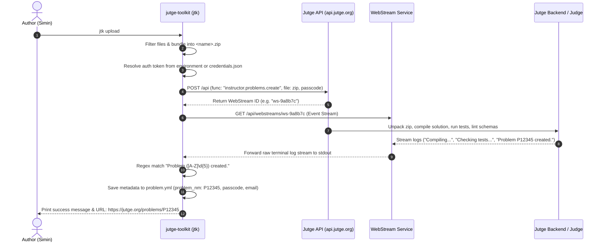

# Problem Definition & Upload Workflow

> **Topic Summary:** A complete technical and operational guide explaining what part of the Jutge platform the professor demonstrated in your initial meeting, the exact documents and source code behind it, the web service protocol, and a step-by-step practical manual for defining, compiling, validating, and uploading problems using your authorized UPC account credentials.

---

## Table of Contents

1. [Executive Summary: What Part of the Project Was This?](#1-executive-summary-what-part-of-the-project-was-this)
2. [Codebase & Documentation Map](#2-codebase--documentation-map)
3. [Under the Hood: Web Service Protocol & Architecture](#3-under-the-hood-web-service-protocol--architecture)
4. [Step-by-Step Practical Guide for Simin](#4-step-by-step-practical-guide-for-simin)
   - [Step 0: Prerequisites & Tool Verification](#step-0-prerequisites--tool-verification)
   - [Step 1: Authenticate with Jutge Web Services (`jtk login` / `jutge login`)](#step-1-authenticate-with-jutge-web-services)
   - [Step 2: Define and Scaffold a Problem Directory](#step-2-define-and-scaffold-a-problem-directory)
   - [Step 3: Local Compilation, Linting, and Verification](#step-3-local-compilation-linting-and-verification)
   - [Step 4: Clean and Upload to Jutge Web Services (`jtk upload`)](#step-4-clean-and-upload-to-jutge-web-services)
   - [Step 5: Post-Upload Configuration, Sharing, and Testing (`jtk share`, `jtk submit`)](#step-5-post-upload-configuration-sharing-and-testing)
5. [Deep Dive into Implementation Source Code](#5-deep-dive-into-implementation-source-code)
   - [Authentication Hierarchy (`lib/login.ts`)](#authentication-hierarchy-liblogints)
   - [Packaging and Upload Logic (`lib/upload.ts`)](#packaging-and-upload-logic-libuploadts)
   - [API Client & WebStream Streaming (`lib/jutge_api_client.ts`)](#api-client--webstream-streaming-libjutge_api_clientts)
6. [Tool Comparison: `jtk` vs `jutge` CLI](#6-tool-comparison-jtk-vs-jutge-cli)
7. [Safety Invariants & Common Pitfalls](#7-safety-invariants--common-pitfalls)
8. [Meeting Preparation Talking Points](#8-meeting-preparation-talking-points)

---

## 1. Executive Summary: What Part of the Project Was This?

In your first kickoff meeting on October 22, 2026, Professor Jordi Petit opened a terminal, defined a problem directory, authenticated with his instructor credentials, and uploaded the problem directly to Jutge.org.

### What Specific Part of the Project Does This Represent?

This demonstration showed the **Authoring and Publishing Ingestion Pipeline** of Jutge.org:

```
[ Problem Authoring / AI Generation ]
           │
           │  (Generates directory: *.pbm with solution.cc, handler.yml, tests)
           ▼
[ Local Verification & Build (jtk make / jtk lint) ]
           │
           │  (Validates syntax, outputs, time limits locally)
           ▼
[ Jutge Web Service Ingestion (jtk upload) ]
           │
           ├── 1. Packages .pbm into temporary zip (excluding object files and binaries)
           ├── 2. Authenticates via UPC account token / instructor session
           ├── 3. POSTs payload to https://api.jutge.org/api (instructor.problems.create)
           ├── 4. Streams server-side compiler/judge validation logs
           └── 5. Receives assigned Problem ID (e.g., P12345 or X98765) and writes problem.yml
           ▼
[ Production Judge System (Jutge.org) ]
           │
           └── Students submit code; judge executes sandboxed test runs
```

### Why Did the Professor Demonstrate This in the Terminal?

Unlike commercial learning platforms where instructors manually paste statements and upload test cases through web forms, **Jutge is engineered as an automated, terminal-first, code-driven ecosystem**:
1. **Source of Truth is Code:** A problem is a self-contained directory (`<name>.pbm`) under version control.
2. **Deterministic Grading:** The server must compile the golden solution, run the test generators, verify time limits, and build the grading jail before any student can see the problem.
3. **API-First Architecture:** The web frontend (`jutge.org`) is a consumer of the underlying REST API (`api.jutge.org`). The CLI (`jtk`) interacts with the exact same API endpoints that power the production system.

### How Does This Connect to Your Scholarship?

Your scholarship project focuses on modernizing problem creation using AI agents (the `problem-editor` project and Claude Code skills). 
- **Upstream (Your core work):** AI synthesizes high-quality, pedagogically sound problem folders (`.pbm`) following strict C++17 rules, efficiency tests, and bilingual statements.
- **Downstream (The professor's demo):** The output of that AI synthesis must be ingested by Jutge. The command `jtk upload` is the bridge between your generated problem directory and the live platform.

---

## 2. Codebase & Documentation Map

The behavior demonstrated by your professor is implemented across two main repositories in `resources/jutge_repos/`:

| Component | Repository | Key Paths | Purpose |
|---|---|---|---|
| **Authoring CLI** | `jutge-toolkit` | [`docs/getting-started-guide.md`](file:///Users/siminshoeibizadeh/mienne/Programming/dev/projects/scholarship-project-uni/jutge-private/resources/jutge_repos/jutge-toolkit/docs/getting-started-guide.md#L238-L260)<br>[`docs/reference.md`](file:///Users/siminshoeibizadeh/mienne/Programming/dev/projects/scholarship-project-uni/jutge-private/resources/jutge_repos/jutge-toolkit/docs/reference.md#L109-L150)<br>[`docs/problem-anatomy.md`](file:///Users/siminshoeibizadeh/mienne/Programming/dev/projects/scholarship-project-uni/jutge-private/resources/jutge_repos/jutge-toolkit/docs/problem-anatomy.md) | Official author documentation for problem format, compilation, login, upload, and sharing. |
| **Upload Logic** | `jutge-toolkit` | [`lib/upload.ts`](file:///Users/siminshoeibizadeh/mienne/Programming/dev/projects/scholarship-project-uni/jutge-private/resources/jutge_repos/jutge-toolkit/lib/upload.ts)<br>[`toolkit/upload.ts`](file:///Users/siminshoeibizadeh/mienne/Programming/dev/projects/scholarship-project-uni/jutge-private/resources/jutge_repos/jutge-toolkit/toolkit/upload.ts) | Implementation of zip archive creation, exclusion filters, RPC call to `instructor.problems.create`, webstream log listener, and `problem.yml` creation. |
| **Auth Logic** | `jutge-toolkit` | [`lib/login.ts`](file:///Users/siminshoeibizadeh/mienne/Programming/dev/projects/scholarship-project-uni/jutge-private/resources/jutge_repos/jutge-toolkit/lib/login.ts) | Resolution order for credentials: environment variables, `jutge-cli` config file, and interactive terminal prompt. |
| **API Client** | `jutge-toolkit` | [`lib/jutge_api_client.ts`](file:///Users/siminshoeibizadeh/mienne/Programming/dev/projects/scholarship-project-uni/jutge-private/resources/jutge_repos/jutge-toolkit/lib/jutge_api_client.ts#L4713-L4940) | TypeScript client calling `instructor.problems.create`, `instructor.problems.update`, and `instructor.problems.setSharingSettings`. |
| **General CLI** | `jutge-cli` | [`README.md`](file:///Users/siminshoeibizadeh/mienne/Programming/dev/projects/scholarship-project-uni/jutge-private/resources/jutge_repos/jutge-cli/README.md#L31-L100) | General terminal interface for students/instructors; manages saved tokens and multi-account configurations in `credentials.json`. |
| **Meeting Notes** | `original-info` | [`meeting notes 20261022.md`](file:///Users/siminshoeibizadeh/mienne/Programming/dev/projects/scholarship-project-uni/jutge-private/resources/original-info-from-professors/meeting%20notes%2020261022.md#L22) | Line 22: *"our current tools: jtk - this is the main tool that generates problem and pdf and upload etc , you will use it all the time"*. |

---

## 3. Under the Hood: Web Service Protocol & Architecture

When you run `jtk upload` inside a problem directory, here is what happens step by step:



### Detailed Protocol Details:
1. **Endpoint:** `POST https://api.jutge.org/api` (overridable via `JUTGE_API_URL`).
2. **Payload:** HTTP `multipart/form-data`:
   - `data`: JSON string containing `{ func: "instructor.problems.create", input: passcode, meta: { token }, userAgent: "typescript-client" }`.
   - `file_0`: The zipped `.pbm` archive.
3. **WebStream Feedback:** Problem creation is an asynchronous, heavy server operation. Rather than a long-polling HTTP request that could time out, the API returns a stream identifier. The client opens `GET /api/webstreams/<id>` and streams the server's build and verification logs directly into your terminal in real time.
4. **Assigned Problem ID:** The server assigns a canonical identifier (for example, `P12345` or `X98765`). Once `jtk` detects this in the log stream, it creates a local file named `problem.yml` containing:
   ```yaml
   problem_nm: P12345
   email: simin.shoeibi@estudiantat.upc.edu
   passcode: abcdefgh1234
   shared_testcases: false
   shared_solutions: false
   created_at: 2026-11-12T10:00:00.000Z
   updated_at: 2026-11-12T10:00:00.000Z
   ```
5. **Update vs Create:** If `problem.yml` is present in the directory, running `jtk upload` calls `instructor.problems.update(info.problem_nm, file)` instead of creating a duplicate problem.

---

## 4. Step-by-Step Practical Guide for Simin

Because your UPC email (`simin.shoeibi@estudiantat.upc.edu`) has already been authorized in their system with instructor permissions, you can execute this complete authoring and upload pipeline from your terminal.

### Step 0: Prerequisites & Tool Verification

Before starting, confirm your terminal has the necessary toolchain installed.

1. **Check System Tools via `jtk doctor`:**
   ```bash
   jtk doctor
   ```
   This command inspects your local environment for compilers (`g++`, `clang++`, `python3`), LaTeX/PDF tools (`pdflatex`, `pandoc`), and dependencies.

2. **Verify CLI versions:**
   ```bash
   jtk --version
   jutge --version   # If jutge-cli is installed
   ```

---

### Step 1: Authenticate with Jutge Web Services

`jutge-toolkit` requires authentication to verify you have instructor privileges before creating problems on `api.jutge.org`.

You have three options for authentication (Option A is recommended):

#### Option A: Log in interactively via `jtk` or `jutge-cli` (Recommended)
If you have `jutge-cli` installed:
```bash
jutge login
```
Enter your UPC email (`simin.shoeibi@estudiantat.upc.edu`) and password. The credentials and session token are securely stored in:
- **macOS:** `~/Library/Application Support/jutge-cli/credentials.json`
- **Linux:** `~/.config/jutge-cli/credentials.json`

Because `jtk` automatically reads this credentials file (see [`lib/login.ts#L148-L156`](file:///Users/siminshoeibizadeh/mienne/Programming/dev/projects/scholarship-project-uni/jutge-private/resources/jutge_repos/jutge-toolkit/lib/login.ts#L148-L156)), any subsequent `jtk` command will immediately recognize your active session without prompting you again.

#### Option B: Let `jtk` prompt you on demand
If you do not run `jutge login` beforehand, running any command requiring authorization (such as `jtk upload`) will automatically prompt you in the terminal:
```text
? Select email: simin.shoeibi@estudiantat.upc.edu
? Jutge.org password for simin.shoeibi@estudiantat.upc.edu: [hidden]
✔ Logged in as Simin Shoeibi with email simin.shoeibi@estudiantat.upc.edu
```

#### Option C: Environment Variables (CI/CD or scripted environments)
You can export your credentials or token in your shell:
```bash
export JUTGE_EMAIL="simin.shoeibi@estudiantat.upc.edu"
export JUTGE_PASSWORD="YourPasswordHere"
# Or if you have a personal access token:
# export JUTGE_TOKEN="your-access-token"
```

---

### Step 2: Define and Scaffold a Problem Directory

There are three ways to define a problem directory:

#### Way 1: Use your AI-Generated Problem (Recommended for your demo)
In your workspace, Claude Code has already generated a complete, compliant problem folder:
```bash
# Navigate to your generated problem
cd work/01-meeting-presentation-and-demo-20261112/01-claude-task/dominant-peaks.pbm
```

#### Way 2: Clone an Official Template
`jtk` includes built-in reference templates that you can clone:
```bash
# Interactive selector:
jtk clone

# Or direct clone into a new folder:
jtk clone standard/maximum-of-2-integers.pbm -d my-problem.pbm
cd my-problem.pbm
```

#### Way 3: Create from Scratch via Interactive AI
```bash
jtk generate problem --kind io
```
This prompts for a title, short story/description, language, and generates the starter files.

---

### Step 3: Local Compilation, Linting, and Verification

Never upload an untested problem. Run the local verification sequence:

1. **Lint the Problem Directory:**
   ```bash
   jtk lint -v
   ```
   Validates schema compliance of `handler.yml`, checks for forbidden files, and ensures naming conventions (`sample-*.inp`, `private-*.inp`) are satisfied.

2. **Generate Executables & Test Outputs (`.cor`):**
   ```bash
   jtk make exe cor
   ```
   Compiles `solution.cc` and runs it against all `.inp` inputs to generate the official `.cor` files.

3. **Verify Candidate / Slow Solutions:**
   ```bash
   jtk verify solution-slow.cc
   ```
   Tests alternate solutions to confirm that naive approaches fail on large efficiency tests (e.g., TLE) while passing small correctness tests.

---

### Step 4: Clean and Upload to Jutge Web Services

1. **Clean Temporary and Build Artifacts:**
   Before uploading, always run `clean`. This prevents bulky object files (`.o`), executables, and compiler caches from being packaged into the zip archive:
   ```bash
   jtk clean
   ```

2. **Publish to Jutge.org:**
   ```bash
   jtk upload
   ```

3. **What You Will See in the Terminal:**
   ```text
   ✔ Logging in to Jutge.org
     ✔ Logged in as Simin Shoeibi with email simin.shoeibi@estudiantat.upc.edu
   ✔ Zipping problem to .jtk-zip/a1b2c3d4/dominant-peaks.zip
     adding dominant-peaks.pbm/handler.yml
     adding dominant-peaks.pbm/problem.en.tex
     adding dominant-peaks.pbm/solution.cc
     adding dominant-peaks.pbm/generate.ts
     adding dominant-peaks.pbm/scores.yml
   ✔ Creating problem in Jutge.org
     [Server] Uploading archive (42 KB)...
     [Server] Unpacking problem dominant-peaks...
     [Server] Running lint checks...
     [Server] Compiling solution.cc with G++17...
     [Server] Running test generators...
     [Server] Generating statement PDF...
     [Server] Problem P98421 created.
   ✔ Creating problem.yml
     ✔ Created problem.yml
   
   problem.yml:
     problem_nm: P98421
     email: simin.shoeibi@estudiantat.upc.edu
     passcode: xK9qL2mP4vR8
     shared_testcases: false
     shared_solutions: false
     created_at: 2026-11-12T10:45:00.000Z
     updated_at: 2026-11-12T10:45:00.000Z

   https://jutge.org/problems/P98421
   ```

> [!IMPORTANT]
> **Never modify `problem.yml` manually!**
> This file is generated by `jtk upload` to bind your local directory to the remote problem identifier on Jutge.org. If you need to make changes to the problem, edit your source files locally and run `jtk upload` again. `jtk` will detect `problem.yml` and perform an **update** rather than creating a duplicate.

---

### Step 5: Post-Upload Configuration, Sharing, and Testing

Once the problem is uploaded, you can manage permissions and verify it directly from the terminal:

1. **Inspect Sharing Settings:**
   ```bash
   jtk share show
   ```

2. **Allow Other Instructors to See Solutions and Test Cases:**
   ```bash
   jtk share --testcases --solutions
   ```

3. **Set or Change Access Passcode:**
   ```bash
   # Set a custom secret passcode
   jtk share --passcode SecretPasscode123

   # Or email the passcode to your professors for review:
   jtk share with jpetit@cs.upc.edu pau.fernandez@upc.edu -t "Here is the dominant mountain peaks problem"
   ```

4. **Submit a Solution to Verify the Remote Judge Verdict:**
   ```bash
   jtk submit -l C++17 solution.cc
   ```
   This submits `solution.cc` to `api.jutge.org` as if you were a student, polls the verdict, and prints:
   ```text
   Submitting solution.cc to P98421...
   Verdict: 🟢 AC (Accepted) [0.38s, 14.2 MB]
   ```

---

## 5. Deep Dive into Implementation Source Code

Understanding the exact source files that power this workflow gives you technical confidence when discussing the architecture with your supervisors.

### Authentication Hierarchy (`lib/login.ts`)

In [`resources/jutge_repos/jutge-toolkit/lib/login.ts`](file:///Users/siminshoeibizadeh/mienne/Programming/dev/projects/scholarship-project-uni/jutge-private/resources/jutge_repos/jutge-toolkit/lib/login.ts#L172-L192), `getLoggedInJutgeClient()` runs every time an authenticated operation begins:

```typescript
// Resolution order:
1. Token from JUTGE_TOKEN environment variable
2. Token from credentials.json (from jutge-cli)
3. Email/Password from JUTGE_EMAIL and JUTGE_PASSWORD
4. Email/Password from credentials.json (saved password)
5. Interactive prompt in terminal asking user for email and password
```

After authenticating, it invokes `jutge.student.profile.get()` and prints:
```typescript
tui.success(`Logged in as ${profile.name} with email ${profile.email}`)
```

### Packaging and Upload Logic (`lib/upload.ts`)

In [`resources/jutge_repos/jutge-toolkit/lib/upload.ts`](file:///Users/siminshoeibizadeh/mienne/Programming/dev/projects/scholarship-project-uni/jutge-private/resources/jutge_repos/jutge-toolkit/lib/upload.ts#L15-L33), notice the exclusion filter:

```typescript
function accept(file: string): boolean {
    const extensionsToExclude = ['.exe', '.o', '.hi', '~', '.bak', '.class', '.pyc', '.pyo']
    const prefixesToExclude = [toolkitPrefix() + '-', '__MACOSX', '.DS_Store', '.', '__pycache__']
    // Filters out object files, executables, OS files, and hidden directories
}
```

Then in `createProblemInJutgeOrg` ([lines 100-134](file:///Users/siminshoeibizadeh/mienne/Programming/dev/projects/scholarship-project-uni/jutge-private/resources/jutge_repos/jutge-toolkit/lib/upload.ts#L100-L134)):
```typescript
const file = await createFileFromPath(zipFilePath, 'application/zip')
const { id } = await jutge.instructor.problems.create(info.passcode, file)
const problem_nm = await showTerminalOutput(id)

info.problem_nm = problem_nm
await saveProblemYml(directory, info, 'Created')
```

### API Client & WebStream Streaming (`lib/jutge_api_client.ts`)

In [`resources/jutge_repos/jutge-toolkit/lib/jutge_api_client.ts`](file:///Users/siminshoeibizadeh/mienne/Programming/dev/projects/scholarship-project-uni/jutge-private/resources/jutge_repos/jutge-toolkit/lib/jutge_api_client.ts#L4906-L4915):

```typescript
/**
 * Create a problem from a ZIP archive.
 * Authentication: instructor
 * This endpoint uses terminal web streaming: It returns an id from which 
 * the problem feedback is streamed over <URL>/api/webstreams/<id>.
 */
async create(passcode: string, ifile: File): Promise<WebStream> {
    const [output, ofiles] = await this.root.execute("instructor.problems.create", passcode, [ifile])
    return output
}
```

The function `showTerminalOutput(id)` reads the raw byte stream chunks via `TextDecoder` and uses regex to capture the newly assigned ID:
```typescript
const matchCreated = text.match(/Problem ([A-Z]\d{5}) created\./)
if (matchCreated) problem_nm = matchCreated[1]
```

---

## 6. Tool Comparison: `jtk` vs `jutge` CLI

Both tools live in the ecosystem, and it is helpful to know their distinct roles:

| Feature | Jutge Toolkit (`jtk`) | Jutge CLI (`jutge`) |
|---|---|---|
| **Primary Audience** | Problem Authors, Content Designers, Teaching Assistants | Students, General Instructors, Course Administrators |
| **Problem Authoring** | Full support (`make`, `lint`, `generate`, `clone`) | No authoring tools |
| **Problem Publishing** | `jtk upload`, `jtk share`, `jtk remove` | Querying & inspection commands |
| **Account Management** | Reuses `jutge-cli` accounts or prompts directly | Advanced multi-account switching (`jutge accounts use prof`) |
| **Submission Testing** | `jtk submit` directly inside `.pbm` directory | `jutge student submissions submit` |
| **Installation** | Global executable or npm package `@jutge.org/toolkit` | `bun install -g @jutge.org/cli` |

---

## 7. Safety Invariants & Common Pitfalls

1. **Do Not Author `problem.yml` Manually:**
   `problem.yml` represents the server-assigned identity of the problem. If you invent an ID or copy `problem.yml` from another problem, `jtk upload` will attempt to overwrite someone else's problem or fail with an authorization error.
2. **Always Run `jtk clean` Before Uploading:**
   Uploading uncleaned directories sends large compiler binaries and intermediate object files across the wire, slowing down the upload and potentially hitting file size limits.
3. **Never Author `.cor` Files by Hand:**
   Jutge requires `.cor` files to be deterministically produced by compiling and executing `solution.cc` through `jtk make cor`.
4. **Instructor Role Requirement:**
   The `instructor.problems.create` endpoint is strictly guarded. If you log in with an unauthorized student account, the API will reject the request with `UnauthorizedError`. Your UPC email (`simin.shoeibi@estudiantat.upc.edu`) has already been granted instructor permissions by the supervisors.

---

## 8. Meeting Preparation Talking Points

When you meet with Professor Jordi Petit and Pau Fernandez, you can connect your work directly to his terminal demonstration:

- **Reference the Demo:**  
  *"In our first meeting, you demonstrated how `jtk upload` communicates with `api.jutge.org` via the instructor module and webstreams to ingest a `.pbm` folder."*
- **Highlight Your Progress:**  
  *"For Phase 1 & 2 of the problem-editor project, I used Claude Code to generate a production-ready problem directory (`dominant-peaks.pbm`) following your exact C++17 constitution, efficiency tests, and scores configuration."*
- **Demonstrate Readiness:**  
  *"I've thoroughly studied the `jtk upload` packaging lifecycle (`lib/upload.ts`, `lib/login.ts`). My UPC email is authorized in the system, so we can test running `jtk lint`, `jtk make`, and `jtk upload` on our newly generated problem together whenever you'd like."*

---

## Related Documentation & Further Reading

- [Jutge Private Workspace Root Map](../../../README.md)
- [Ecosystem Architecture & Repositories Guide](../../understanding/02-ecosystem.md)
- [Jutge Toolkit (`jtk`) Execution Architecture](../../understanding/03-jtk-architecture.md)
- [Problem Format, Scoring, and Grading Specifications](../../understanding/04-problem-format-and-grading.md)
- [Dominant Peaks Generated Problem Workspace](../../../work/01-meeting-presentation-and-demo-20261112/01-claude-task/dominant-peaks.pbm/)
