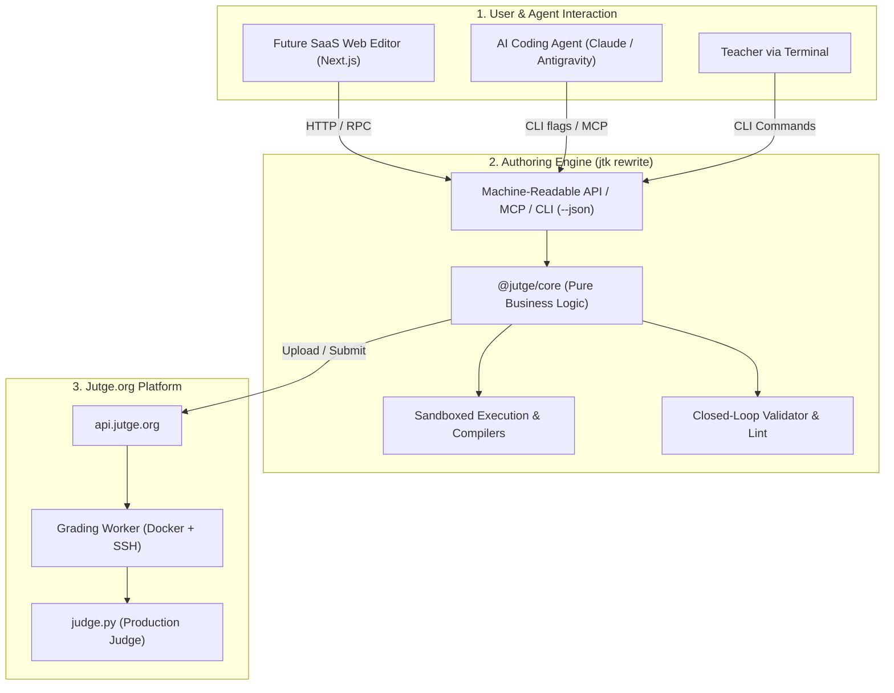

# Senior Developer Project Brief: Jutge & Problem-Editor

> **Audience:** Senior Software Engineer onboarding to the Jutge scholarship project.  
> **Purpose:** 15-minute executive architectural briefing covering domain, codebase state, and 4-month roadmap.

---

## 1. Executive Context & The Core Problem

### What is Jutge.org?
[Jutge.org](https://jutge.org) is the automated grading and computer science learning platform used across universities in Barcelona (primarily UPC - Barcelona Tech). It has hundreds of thousands of student submissions across C++, Python, Haskell, and other languages.

### The Problem
- **Problem exhaustion & leakage:** Public problems quickly get solved, shared, or memorized.
- **High authoring barrier:** Creating a robust, battle-tested programming problem takes hours: writing formal LaTeX statements, authoring golden solutions, building edge-case test generators, creating wrong/slow solutions to verify grading limits, and packaging everything into specific YAML metadata.
- **Teacher friction:** Most university teachers find the current manual CLI tooling too complex or fragile.

### The Objective of this 4-Month Internship
You are here to solve this at the foundational software layer. Specifically:
1. **Re-architect & rebuild `jtk` (Jutge Toolkit):** Turn the existing monolithic CLI into a robust, decoupled, testable engine with a scriptable CLI / MCP interface.
2. **Enable the Problem Editor SaaS & AI Agent:** Build the programmatic backbone that allows an AI Agent (and eventual Next.js web SaaS) to draft, compile, test, verify, and package problems deterministically in a closed feedback loop.

---

## 2. High-Level System Architecture



### The Key Repositories & Actors
- **Professors / Stakeholders:**
  - **Jordi Petit:** Jutge creator, project lead. Authored most of Jutge and existing `jtk`.
  - **Pau Fernandez:** Co-maintainer. Authored the `problem-editor` specification, AI skills, and sample exam.
- **Upstream Repositories** (mirrored in `resources/jutge_repos/`):
  - `jutge-toolkit` (`jtk`): Bun/TypeScript CLI for teachers to manage problems.
  - `jutge-driver-std`: The server-side Python grading driver that determines ground truth for test execution.
  - `problem-editor`: Pau's initial repo containing problem specifications, AI skills, and reference models.

---

## 3. The Core Domain Entity: The Problem Folder (`.pbm`)

A problem in Jutge is stored as a directory ending with `.pbm`. It has a strict filesystem contract:

| File | Purpose | Source / Invariant |
|---|---|---|
| `handler.yml` | Execution schema (problem type, compiler, checker rules, tolerances) | Authored / Generated |
| `problem.<lang>.tex` | Formal LaTeX statement (e.g. `problem.en.tex`, `problem.fr.tex`) | Authored / Generated |
| `problem.<lang>.yml` | Metadata (title, author, email, translation status) | Authored / Generated |
| `solution.<ext>` | The **Golden Solution** (reference implementation) | Authored / Generated |
| `solution-*.<ext>` | Alternative solutions (slow algorithms, wrong answers for test tuning) | Optional |
| `*.inp` | Input test files (`sample-*.inp` are public; others are private) | Generated by script |
| `*.cor` | **Expected Correct Output** | **ALWAYS generated by running `jtk make` with the golden solution. Never written by an LLM or human.** |
| `problem.yml` | Server assignment ID and passcode | Written by Jutge API upon `jtk upload` |

---

## 4. Current State & Technical Debt Assessment

The current `jtk` (v4.4.50, Bun + TypeScript) was a quick migration from a legacy Python codebase. It has critical architectural debt:

1. **Zero Test Coverage:** No unit tests, integration tests, or CI fixtures.
2. **Coupled Business Logic & TUI:** File I/O, compilation, and `@inquirer/prompts` / `chalk` console logging are interleaved in the same functions. It cannot be consumed as an npm library or driven cleanly by an automated agent.
3. **Open-Loop AI Generation:** `jtk generate` queries an LLM via the Jutge API, writes the raw string output directly to disk, and stops. It never compiles the code, never runs the tests, and never checks if the generated problem even works.
4. **No Local Sandboxing or Execution Timeouts:** Running `jtk make` executes compiled binaries directly on the host machine. If a solution has an infinite loop or allocates 16 GB RAM, the build hangs or crashes the host.
5. **Human-Only CLI Contract:** Output is colored terminal text with interactive prompts. There is no `--json` output flag or structured exit codes for agent self-correction.

---

## 5. Clean Workspace Structure (No Folder Duplication)

To avoid duplicating large repos while keeping your local workspace clean and version-controlled:

```
jutge-private/
├── resources/           # [READ-ONLY REFERENCE] Upstream code & professor materials
│   ├── jutge_repos/     # Upstream git clones (jutge-toolkit, drivers, etc.)
│   └── professor gave 2026-10-25/problem-editor/  # Upstream problem-editor repo
│
├── doc/                 # [DOCUMENTATION & MEETINGS] Analysis, study notes, reports
│   ├── SENIOR-DEV-BRIEF.md              # This onboarding file
│   ├── ai-analysis-20261103/            # Verified technical deep dive (files 00-08)
│   ├── task-01-problem-editor-analysis/ # In-depth analysis of problem-editor
│   └── task-02-meeting-20261022-next-steps/ # Follow-ups & meeting prep
│
└── work/                # [ACTIVE DEVELOPMENT] Your code, POCs, and PR staging
    ├── README.md        # Work log and active branch tracking
    └── (poc / modules)  # Your clean code without touching resources/
```

**Rule of thumb:**
- Never edit code inside `resources/` directly. When professors push updates, you simply run `git pull` inside `resources/professor gave 2026-10-25/problem-editor` or `resources/jutge_repos/*`.
- All your experiments, clean architectural modules, and POCs live in `work/` or in dedicated git branches.

---

## 6. Prioritized 4-Hour Study Plan

You have **4 hours** total to ramp up. Do not read the entire corpus; follow this high-yield path:

### Hour 1: Domain & The Problem Spec (60 min)
1. Read this brief (`doc/understanding/01-senior-dev-brief.md`) — 10 min.
2. Read [04. Problem Format & Grading](./04-problem-format-and-grading.md) — 15 min.
3. Open and inspect the reference models: [Reference Models Guide](../problem-editor-en-translate-20261111/spec/models-guide.md) — 20 min.
4. Skim the pedagogical rules: [Pedagogical Constitution](../problem-editor-en-translate-20261111/spec/constitution.md) (lines 1–50) — 15 min.

### Hour 2: The Problem Editor Vision & Agent Skills (60 min)
1. Read Pau's vision: [Problem Editor Complete English Translation](../problem-editor-en-translate-20261111/README.md) — 15 min.
2. Read [05. AI Problem Generation Analysis](./05-ai-problem-generation-analysis.md) — 20 min.
3. Read the agent skill file: [Problem Creation Skill](../problem-editor-en-translate-20261111/skills/jutge-problems/SKILL.md) — 15 min.
4. Inspect the Claude generation guide: [Phase 1 & 2 Execution Guide](../../work/01-claude-problem-generation-20261111/README.md) — 10 min.

### Hour 3: Existing `jtk` Codebase & Architectural Debt (60 min)
1. Read [03. jtk Architecture](./03-jtk-architecture.md) — 15 min.
2. Read [06. jtk Rewrite Observations](./06-jtk-rewrite-observations.md) — 25 min.
3. Skim real source code to see the coupling: [jtk maker.ts](../../resources/jutge_repos/jutge-toolkit/lib/maker.ts) and [jtk problem.ts](../../resources/jutge_repos/jutge-toolkit/lib/problem.ts) — 20 min.

### Hour 4: Meeting Strategy & Proposal Selection (60 min)
1. Review the 3 proposals in Section 7 below.
2. Formulate your talking points and open architectural questions for Jordi and Pau.

---

## 7. Concrete Proposals for the November 12th Meeting

To prove high seniority and immediate value in your first milestone meeting, here are three proposal options:

### Proposal A: The Technical Architecture RFC & 4-Month Roadmap (Strategic Lead)
- **What it is:** A formal 3-page design proposal: *"jtk v5: Decoupled Core, Machine-Readable Agent Contract, and Closed-Loop Verification"*.
- **Contents:**
  1. **Architecture:** Monorepo package structure (`@jutge/core` for pure headless engine, `@jutge/cli` for TUI, `@jutge/agent-bridge` for MCP/AI).
  2. **Scriptable Contract:** Standardized `--json` diagnostics and exit code matrix for AI tool calls.
  3. **Testing Harness:** Automated Vitest test suite using real `.pbm` fixtures.
  4. **16-Week Roadmap:** Month 1 (Core extraction & test harness), Month 2 (Closed-loop verification & CLI agent contract), Month 3 (Problem Editor API / MCP), Month 4 (Web editor integration & migration).

### Proposal B: Working Proof-of-Concept — Closed-Loop Verifier (Tangible Engineering)
- **What it is:** A working TypeScript module in `work/` implementing the single most requested capability from Pau's README: **a deterministic problem validation runner that reports machine-readable JSON**.
- **What it does:**
  - Given a `.pbm` directory (or draft files), it runs linting, compiles the golden solution, runs the generator, compares test outputs, and emits a structured JSON report (`{ valid: boolean, errors: [...], benchmarks: {...} }`).
  - Proves how an AI agent can self-correct when an error occurs instead of dumping broken files.

### Proposal C: Upstream `problem-editor` Bug Fixes & Spec Audit (Immediate Contributions)
- **What it is:** A targeted pull request / commit series for `problem-editor`:
  - Fixes contradictions in the problem specification (e.g. 5x vs 3x slow solution threshold).
  - Supplies missing template files (`spec/templates/*`).
  - Adds an automated validation script that verifies all 7 model problems against `jtk lint`.

> **Recommended Strategy:** Combine **Proposal A (Executive RFC & Roadmap)** as your discussion document, accompanied by a lightweight **Proposal B prototype** to show working execution.

