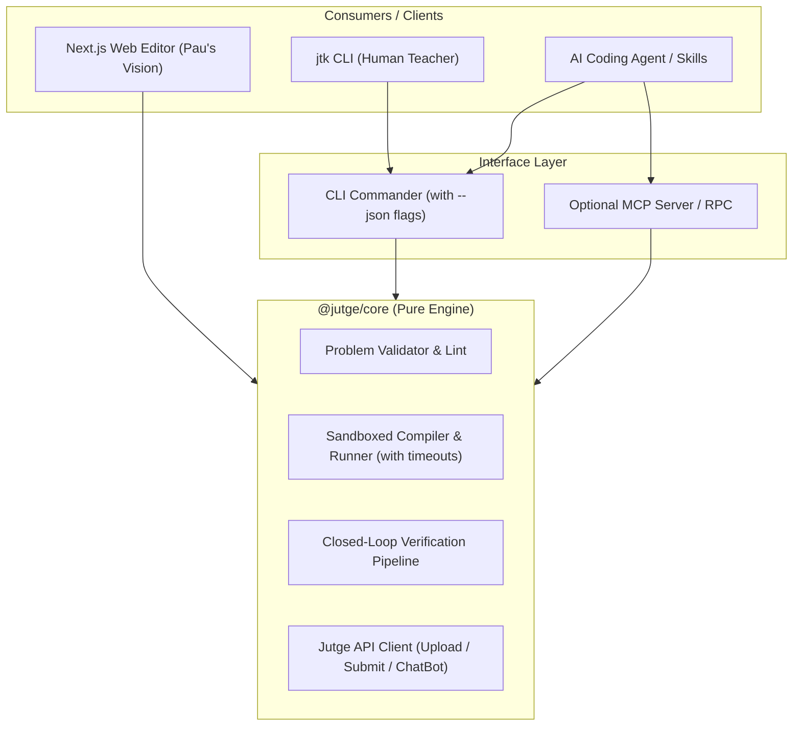

# Engineering Proposal: jtk v5 Architecture & 4-Month Roadmap

> **Presented to:** Prof. Jordi Petit & Pau Fernández  
> **Author:** Simin Shoeibi  
> **Date:** November 12, 2026  
> **Subject:** Restructure & Rebuild of `@jutge.org/toolkit` (`jtk`) and Problem-Editor AI Integration

---

## 1. Executive Summary & Findings

Over the past two weeks, I conducted an architectural review of `jutge-toolkit` (v4.4.50), the judge execution pipeline (`jutge-driver-std`), and the `problem-editor` specification repository.

### Key Architectural Strengths to Retain
*   **The `.pbm` format:** The single-source-of-truth problem format (`handler.yml`, `problem.<lang>.tex`, `solution.<ext>`, `*.inp`, `*.cor`) is clean and well-understood by server drivers.
*   **Zod schema validation:** Excellent validation baseline for configuration files.
*   **TUI commands:** `doctor`, `lint`, and `completion` are valuable for developer experience.

### Bottlenecks Blocking the AI Problem-Editor Vision
1. **Interactive Coupling:** Business logic (compilation, `.cor` generation, verification) is tightly coupled with terminal prompts (`@inquirer/prompts`) and console logs. It cannot currently be consumed as an imported headless package or driven by an external agent.
2. **Open-Loop AI Problem Generation:** Current `jtk generate` sends one-shot prompts to the Jutge API and writes raw strings to disk. It does not compile the code or execute test generators to verify correctness.
3. **Absence of Automated Tests:** Zero unit or integration tests exist in the codebase.
4. **Local Execution Risk:** `jtk make` executes compiled binaries without execution sandboxing or timeouts; an accidental infinite loop hangs the local build.

---

## 2. Proposed System Architecture (jtk v5)

### Core Design Principles
1. **Decoupled Engine (`@jutge/core`):** Pure functions, zero `@inquirer` or `chalk` imports. Returns strongly-typed result objects (`Result<T, E>`).
2. **Machine-Readable CLI Contract:** Every command supports a `--json` flag and deterministic exit codes, giving AI agents structured feedback to self-correct.
3. **Closed-Loop Generation:** Generating a problem automatically compiles the golden solution, runs the test generator, verifies limits, and returns compiler errors back to the agent before saving.
4. **Test-Driven Foundation:** Vitest suite running against a corpus of real `.pbm` fixtures.

---

## 3. 4-Month Roadmap

| Month | Focus | Core Deliverables |
|---|---|---|
| **Month 1 (Nov–Dec)** | **Foundational Core & Test Harness** | • Extract `@jutge/core` with strict TypeScript types. • Implement Vitest suite with reference `.pbm` fixtures. • Add sandboxed execution with timeout limits for `make` and `verify`. |
| **Month 2 (Dec–Jan)** | **Scriptable Agent Contract & Closed-Loop** | • Implement standardized `--json` outputs and exit code matrix. • Build closed-loop compiler/test verification pipeline. • Align with Pau's `problem-editor` Claude skills. |
| **Month 3 (Jan–Feb)** | **Problem-Editor & Web Integration** | • Connect core authoring engine with Next.js web editor backend. • Support multi-language problem types (C++ G++17/PRO2, Python). • Automated test suite validation across `private-problems/`. |
| **Month 4 (Feb–Mar)** | **Hardening & Production Release** | • Production packaging and npm distribution. • Migration guide from `jtk v4` to `jtk v5`. • Documentation and teacher walkthroughs. |

---

## 4. Key Decisions for Today's Meeting

1. **Repository & PR Workflow:** Should we develop in a new repository (e.g. `jutge-toolkit-v5`) or as a feature branch on `jutge-toolkit`? Who will review PRs?
2. **AI Interface Priority:** Should we prioritize a CLI `--json` contract first, or build an official MCP server alongside it?
3. **Initial Scope:** Shall we focus our Month 1 test fixtures exclusively on C++ (`G++17` / `PRO2`), or include Python problems from the start?

